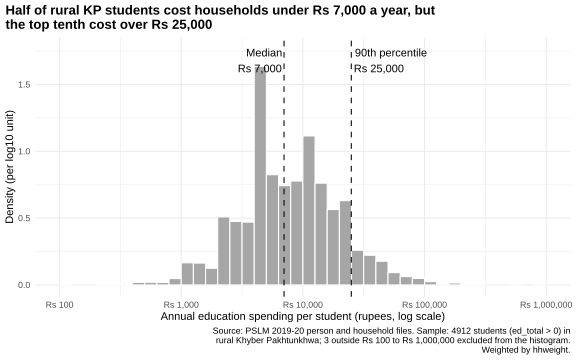
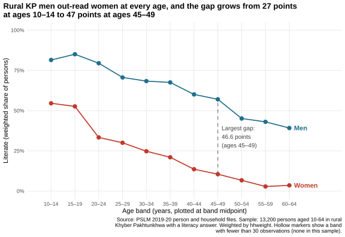
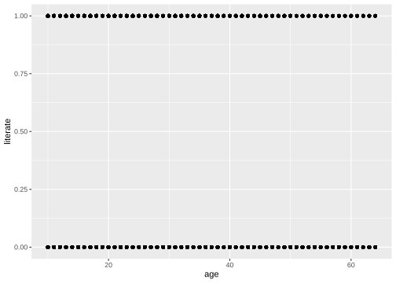
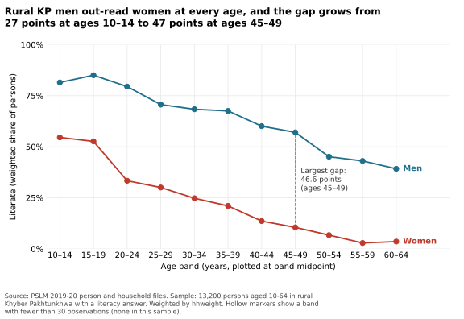

# ECO346-A1-FA24-BEDS-084
# ECO346-A1-FA24-BEDS-084

**ECO346 Data Visualization Techniques for Economists, Assignment 1, Fall 2026**
COMSATS University Islamabad, Lahore Campus. Section B.
Student: Ayesha Abbas, FA24-BEDS-084

## My variant

Registration number ends in 084, and 84 = 10 × 8 + 4, so my variant is **4: Khyber Pakhtunkhwa (KP), rural** (`prov_code == 1`, `urban_rural == 1`).

Data: PSLM 2019–20 person and household files (`data/`). Household weight `hhweight`, province and area are attached to each person by `hhid`. Every statistic is weighted by `hhweight`.

## Figure 1: how much households spend on each student



| Quantity | Value |
|---|---|
| Students (`ed_total` > 0) | 4,912 |
| Weighted median | Rs 7,000 |
| Unweighted median | Rs 7,000 |
| Weighted 10th percentile | Rs 2,500 |
| Weighted 90th percentile | Rs 25,000 |
| P90 / P10 | 10.00 |
| Excluded from the histogram (outside Rs 100 to Rs 1,000,000) | 3 |

Weighted quantiles use the definition in the handout: sort by spending, take the cumulative share of weight, and pick the smallest value where the share reaches the target.

Spending per student is right-skewed. Most students cost between Rs 2,500 and Rs 25,000 a year, a tenfold spread, with a thin tail of high spenders. The weighted and unweighted medians are both Rs 7,000: each is the point where the running total first reaches 50%, and 134 students report exactly Rs 7,000, so that spike holds the crossing in the same place under either method. Household weights are almost uncorrelated with spending, so weighting does not move the middle (the means do differ: Rs 13,249 weighted, Rs 12,608 unweighted).

## Figure 2: literacy by age, women and men



Sample: 13,200 persons aged 10–64 in rural KP with a literacy answer.

| Band | Men (n) | Men literacy % | Women (n) | Women literacy % |
|---|---|---|---|---|
| 10–14 | 1439 | 81.5 | 1210 | 54.6 |
| 15–19 | 1162 | 85.1 | 985 | 52.6 |
| 20–24 | 768 | 79.5 | 906 | 33.3 |
| 25–29 | 580 | 70.6 | 826 | 30.0 |
| 30–34 | 499 | 68.4 | 588 | 24.8 |
| 35–39 | 421 | 67.5 | 546 | 21.0 |
| 40–44 | 357 | 60.1 | 449 | 13.6 |
| 45–49 | 385 | 57.0 | 392 | 10.5 |
| 50–54 | 278 | 45.1 | 384 | 6.7 |
| 55–59 | 255 | 43.0 | 308 | 2.9 |
| 60–64 | 272 | 39.2 | 190 | 3.6 |

No band has fewer than 30 observations for either sex, so no hollow markers appear.

**Key numbers.** Ages 15–19: women 52.6%, men 85.1%. Ages 55–59: women 2.9%, men 43.0%. The largest gap is in the **45–49** band (46.6 points).

**Interpretation.** Literacy is lower in older age bands for both sexes, but far more so for women: 52.6% of women aged 15–19 are literate against 85.1% of men, and by ages 55–59 it is 2.9% against 43.0%. The largest gap is at 45–49 (46.6 points). Because the 35–49 gaps are nearly equal (46.5, 46.5 and 46.6), that peak is a plateau rather than a sharp turn. The pattern is consistent with expanding schooling for younger cohorts, especially girls. It cannot tell us whether literacy changes as people age or by birth cohort, since this is one cross-section.

## The makeover

| Default | Redesign |
|---|---|
|  |  |

The default draws 13,200 points on two stripes at 0 and 1, so overplotting hides everything. I replaced raw points with conditional means (the weighted literacy rate in each five-year band), split by sex, put rates on a common 0–100% scale, labelled the series directly instead of using a legend, removed the grey panel and minor gridlines, and wrote a title that states the finding. The default shows single years of age and how many people sit at each; the redesign hides this.

## Second language: Python

`scripts/04_literacy_python.py` recomputes the band table and redraws Figure 2 as `figures/literacy_by_age_python.svg`. The two band tables agree to one decimal place (it checks this against `tables/band_table_R.csv` when it runs). Women aged 15–19: **52.6%** in R and **52.6%** in Python.



## Repository structure

```
README.md
data/      pslm_person_subset.csv, pslm_hh_subset.csv
scripts/   01_default.R, 02_distribution.R, 03_literacy_by_age.R, 04_literacy_python.py
figures/   default.svg, distribution.svg, literacy_by_age.svg, literacy_by_age_python.svg
tables/    band_table_R.csv, band_table_python.csv
slides/    FA24-BEDS-084.pptx
```

## How to reproduce

Run everything from the repository folder, with no internet needed. R packages: `tidyverse`, `svglite`. Python packages: `numpy`, `pandas`, `matplotlib`.

```
Rscript scripts/01_default.R
Rscript scripts/02_distribution.R
Rscript scripts/03_literacy_by_age.R
python3 scripts/04_literacy_python.py
```

Script 04 must run after script 03, because it compares its table with the one saved by script 03.
